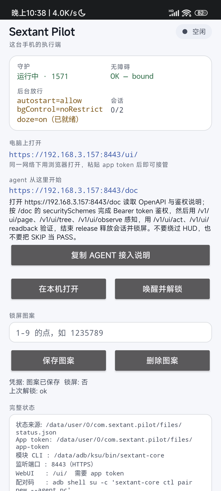
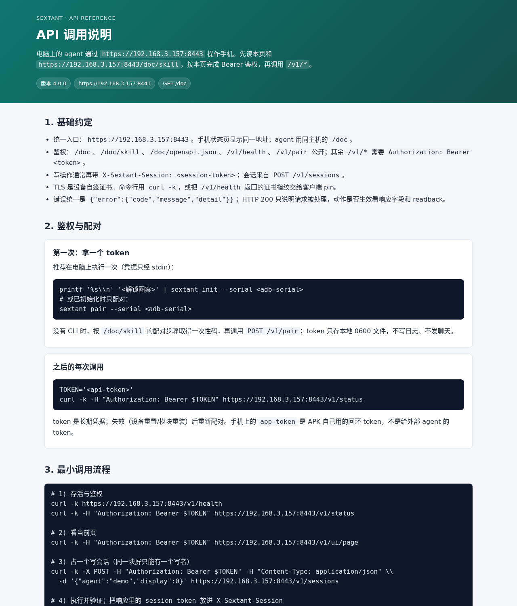
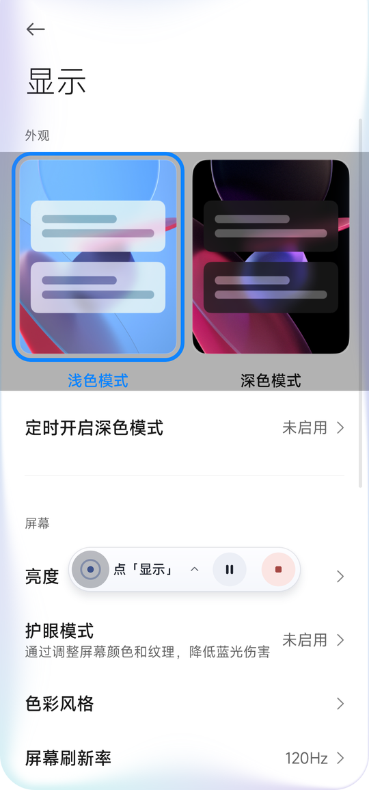

# Sextant — 手机远控

Sextant 让电脑上的 agent 通过 `sextant` CLI 操作一台 Android 手机：看屏、点击、输入、读回结果，人在手机上可以随时暂停或停止。设备端是一个 KernelSU 模块，客户端 APK 零 root。



上图是手机上的状态页。agent 的入口是同一主机上的 `/doc`：手机显示 `https://<手机IP>:8443/ui/` 时，浏览器打开 `https://<手机IP>:8443/doc` 就能看到完整的接口说明页；机器合同在 `/doc/openapi.json`。

## 把这句话发给 agent

```text
打开手机状态页上显示的服务地址，浏览器访问同一主机的 /doc 说明页，按页面完成 Bearer token 鉴权，再读 /doc/skill 操作手册；把 skill 和 token 存到本地（token 文件 0600，不写日志、不回聊天），以后直接用本地缓存调用 /v1/*，不要重复初始化。感知用 page/tree/observe，操作用 act/list/readback 验证，结束 release 释放会话并锁屏；不要绕过 HUD，也不要把 SKIP 当 PASS。
```

完整手册在设备上的 `GET /doc/skill`；电脑装了 CLI 时也可以用 `sextant skill --install ~/.sextant/skills/sextant-remote`。上面这一句只负责把 agent 带进入口。

## 初始化

### 1. 准备

- Android 13 + KernelSU 的设备，已开启开发者选项和 USB/无线 ADB。
- 电脑能运行 `adb`。
- 从 [Releases](https://github.com/zzyyyds88/sextant/releases/latest) 下载：
  - `sextant-core.zip`：设备端模块，内含 APK
  - `sextant-linux-amd64` 或 `sextant-windows-amd64.exe`：电脑侧 CLI

当前真机基线是 Redmi Note 10 Pro 5G / POCO X3 GT（MIUI 14 / Android 13 / KernelSU 3.1.8）。其他 KernelSU 设备需要重新跑验收，不能直接认为兼容。

### 2. 安装设备端模块

```bash
adb push sextant-core.zip /data/local/tmp/
adb shell su -c 'ksud module install /data/local/tmp/sextant-core.zip'
adb reboot
adb wait-for-device
```

模块由 KernelSU 以 root 启动守护进程；APK 不申请 root，也不拉起引擎。重启一次是为了让模块和 priv-app overlay 生效。

### 3. 安装 CLI

Linux：

```bash
install -m 0755 sextant-linux-amd64 /usr/local/bin/sextant
```

Windows 把 `sextant-windows-amd64.exe` 放到 PATH 中，命令名仍是 `sextant`。

如果 adb key 放在独立目录：

```bash
export SEXTANT_ADB_HOME="$HOME/.sextant-adb"
```

### 4. 配对并写入解锁凭据

推荐一条命令完成：

```bash
printf '%s\n' '<解锁图案>' | sextant init --serial <adb-serial>
```

- 解锁图案只经 stdin，不进入 argv、日志或 API。
- 需要 SIM PIN 时加 `--sim`，第二行输入 PIN。
- 没有内置默认 serial；用 `--serial` 或 `SEXTANT_SERIAL` 指定。
- 已配对时不需要重复签发 token。

然后自检：

```bash
sextant doctor
```

8 项都 `ok` 后再使用。`doctor` 会检查配对、守护、a11y、后台、helper、前台页面等。

### 5. 把 `/doc` 交给 agent

手机状态页显示 `https://<手机IP>:8443/ui/`；agent 不需要先有 `sextant` 命令，直接访问同一主机的公开文档：

```bash
curl -k https://<手机IP>:8443/doc                 # HTML 说明页，浏览器直接可读
curl -k https://<手机IP>:8443/doc/openapi.json    # OpenAPI 3.1（/openapi.json 同内容）
curl -k https://<手机IP>:8443/doc/skill           # agent 操作手册
```

`/doc` 是公开入口：先读说明页里的鉴权步骤，完成一次 Bearer token 配对，再调用 `/v1/*`。需要机器合同（路由、schema、`x-sextant-guidance`）时读 `/doc/openapi.json`；`Accept: application/json` 或 `?format=json` 也能让 `/doc` 返回同一份 JSON。CLI 只是这些 HTTP 调用的本地封装，适合人操作；agent 可以完全按 `/doc` 的合同走 HTTP。



第一次接入后把 skill 与 token 留在本地，之后不再初始化：

```bash
sextant skill --install ~/.sextant/skills/sextant-remote   # 存 skill
# 配对得到 token 后写入 0600 文件（不要在终端 echo）：
# ( umask 077; read -r -s T; printf '%s' "$T" > ~/.sextant/agent-token )
```

token 只交给本地 0600 文件或 HTTP 客户端，不写日志、不发到聊天里。设备重置、模块重装或证书变化导致 401 / pin 失败时，才需要重新配对并覆盖本地 token。

### 6. 第一次看屏

```bash
sextant page                    # 前台包/组件/窗口/键盘/页面指纹
sextant shot -o screen.jpg      # 截一张 JPEG
sextant tree --summary          # 无障碍节点树摘要
sextant observe --tree --frame  # 一次返回树和图片
```

## 日常使用

一个最小任务：

```bash
sextant claim agent-a
sextant page
sextant act --text "WLAN" --action click --verify-ms 1500
sextant readback "WLAN"
sextant release <session-id>
```

- `claim` 返回 session id，并解锁屏幕；同一块屏幕只能有一个写会话。
- `act` 必须看 `dispatched`、`verified`、`failure.code`；`verified=false` 就是没生效。
- `readback` 用另一条通道确认结果，不要只信“命令返回 ok”。
- `release` 释放会话并锁屏；本地会话同时删除。
- 长任务用 `sextant heartbeat` 保活；业务操作会刷新活动时间，心跳只保活。默认 300 秒没有业务操作会被当作僵尸会话回收并锁屏。

常用命令：

| 目的 | 命令 |
|---|---|
| 看当前页 | `sextant page`、`sextant tree --summary` |
| 截图/OCR | `sextant shot`、`sextant ocr`、`sextant observe --tree --frame` |
| 点击/输入 | `sextant act --text ... --action click\|select\|set_text` |
| 找控件 | `sextant find "发送"`、`sextant list --text-contains ...` |
| 等待 | `sextant wait "发送"`、`sextant wait-stable` |
| 会话 | `sextant claim`、`sextant heartbeat`、`sextant release` |
| 应用 | `sextant launch PKG`、`sextant stop PKG` |
| 验证 | `sextant doctor`、`sextant acceptance`、`sextant journey` |

## HUD 与人工接管

agent 执行 `claim` 后，手机上会出现 HUD。人可以随时：

- 暂停：注入端点返回 `409 handed_over` / paused，agent 不能继续操作；
- 停止：释放所有会话，agent 需要重新 claim；
- 在手机状态页查看守护、无障碍、后台和会话状态。

agent 不应绕过 HUD；验证码或需要人工判断的页面用 `sextant handover` 交给手机前的人处理。



## 给 agent 的完整启动提示词

一句话版本已在上方；需要更细的步骤时，把下面这段也交给 agent：

```text
你通过 HTTP 控制一台 Android 手机。按顺序工作：

1. 打开手机状态页显示的服务地址，浏览器访问同一主机的 `/doc`（HTML 说明页），
   读鉴权步骤与 `/doc/skill`；需要机器合同时读 `/doc/openapi.json`。
   按文档完成一次 Bearer token 配对，把 skill 与 token 存到本地（token 0600），
   之后直接用本地缓存调用，不重复初始化；不要猜 token，也不要把 token 写进日志或回复。
2. 先确认 `GET /v1/health` 和鉴权后的 `GET /v1/status`；失败就报告原文和复现命令。
3. 感知用 `/v1/ui/page`、`/v1/ui/tree`、`/v1/ui/observe`；操作前 claim，
   用 `/v1/ui/act`、`/v1/ui/list`、`/v1/ui/readback` 并验证结果，
   不要以 HTTP 200 代替生效。
4. 长任务用 `/v1/sessions/{id}/heartbeat` 保活；结束用 release 释放会话并锁屏。
5. 不绕过 HUD/handover；不要把 SKIP 当 PASS；不要伪造成功。
```

## 从旧版本迁移

旧 `chopin-core` / `com.chopin.pilot` 设备用迁移脚本，不要直接覆盖安装：

```bash
SERIAL=<adb-serial> CONFIRM=1 tools/scripts/migrate-to-sextant.sh
```

脚本会先备份旧模块、旧状态和 PC 配置，再卸旧 APK、移除旧模块、安装 Sextant 并重新配对。旧 APK 私有数据会丢失；守护状态会迁移。

## 从源码构建

```bash
tools/scripts/build-core.sh
tools/scripts/build-helper.sh
apps/pilot/build.sh
apps/pc-cli/build.sh
tools/scripts/build-module.sh modules/sextant-core
```

公开仓库不包含 `tools/go`、Android SDK、Kotlin、`scrcpy-server` 和已构建的模块 `lib/`。按脚本头设置 `GO`、`ANDROID_SDK_ROOT`、`ANDROID_BUILD_TOOLS`、`ANDROID_PLATFORM`、`KOTLINC`、`KOTLIN_STDLIB`；把 `scrcpy-server.jar` 放到 `apps/pilot/lib/`。`build-module.sh` 还要求本地 `modules/sextant-core/config/unlock-secret`（0600，不入库）。

## 安全与发布

- 设备端模块由 KernelSU 以 root 启动；APK 零 root，只读守护发布的 `status.json`，唯一特权动作是经 stdin 写解锁凭据。
- release APK 使用专用签名 key，证书 SHA-256 `3bd6c103…`；发布资产附 `SHA256SUMS` 与 GPG 分离签名，公钥见 [`docs/release-key.asc`](docs/release-key.asc)，验证步骤见 [`docs/RELEASE.md`](docs/RELEASE.md)。
- keystore、密码、ADB key、解锁图案、SIM PIN 不入 Git、不发布、不打印。
- 当前发布：[v4.0.0](https://github.com/zzyyyds88/sextant/releases/tag/v4.0.0)。

## 文档

| 文档 | 内容 |
|---|---|
| [`docs/DESIGN.md`](docs/DESIGN.md) | 唯一设计真源、合同与决策 |
| [`docs/ACCEPTANCE.md`](docs/ACCEPTANCE.md) | 验收流程与三条判定 |
| [`docs/RELEASE.md`](docs/RELEASE.md) | 签名、校验和与发布检查 |
| [`modules/sextant-core/README.md`](modules/sextant-core/README.md) | 模块安装、配置、ctl、排障 |
| [`apps/pilot/README.md`](apps/pilot/README.md) | APK 状态页 / HUD / IME |
| [`apps/pc-cli/README.md`](apps/pc-cli/README.md) | CLI 命令与配对 |
| [`AGENTS.md`](AGENTS.md) | agent 协作规则 |
| [`WORKSPACE.md`](WORKSPACE.md) | 开发工作区说明 |

开发机的 ROM/反编译研究资料在 `/root/chopin-research/`，不属于产品交付物；使用 Sextant 不需要它。

## 许可证

AGPL-3.0-or-later，见 [`LICENSE`](LICENSE) 与 [`NOTICE`](NOTICE)。第三方声明保留在 `apps/pilot/licenses/` 和 vendored YAML 目录。
